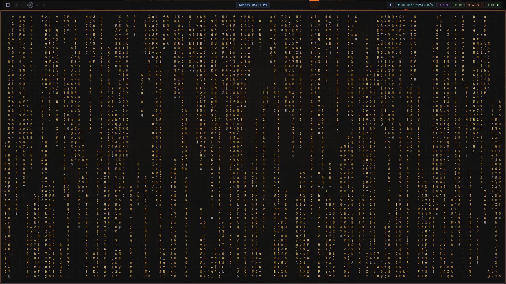

# Omarchy configs with customizations

## bindings

custom added group navigation

## waybar

created my own custom theme for waybar

## hypr

- `looknfeel.conf`: gaps 4, border 1, rounding 8
- `monitors.conf`: scale 1.05
- `input.conf`: `kb_layout = us`, clickfinger off
- `hyprlock.conf`: JetBrainsMono Nerd Font Mono
- `bindings.conf`: music TUI (`cliamp`) bind

## themes (not tracked)

Third-party, install separately: [catppuccin-dark](https://github.com/Luquatic/omarchy-catppuccin-dark)
